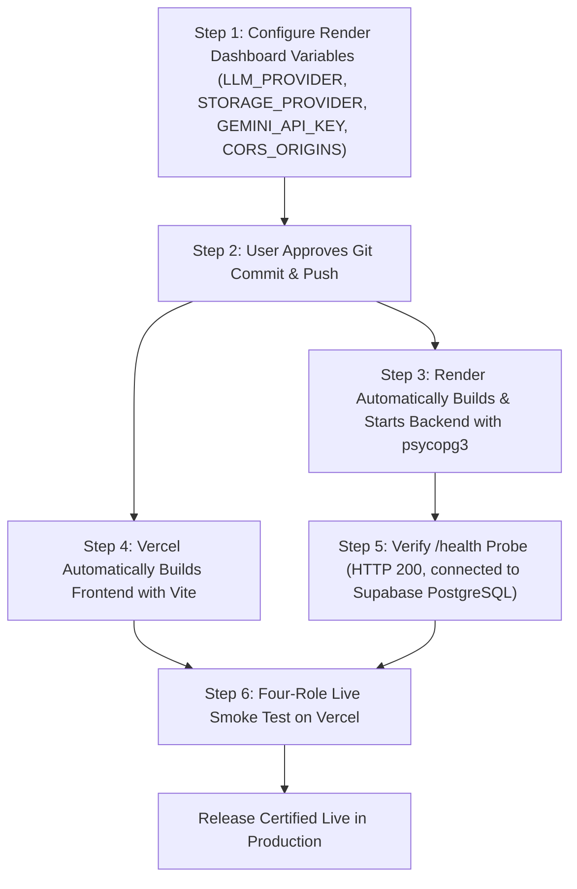

# CivicSense AI OS v5.0 — Final Read-Only Production Release Audit
**Audit Date:** 2026-11-11  
**Auditor:** Principal Software Architect & Release Lead  
**Audit Scope:** Full-Stack Codebase, Security, Infrastructure Preflight, Database Integrity & External Integrations  
**Audit Mode:** STRICT READ-ONLY (No code edits, no DB mutations, no git commits, no deployments)  

---

## Executive Summary & Final Verdict

| Evaluation Dimension | Status | Notes |
| :--- | :---: | :--- |
| **1. Citizen Lifecycle & Workflows** | **PASS** | Registration, duplicate detection (150m Haversine), escalation, feedback, and tracking verified. |
| **2. Field Engineer Assignment Isolation** | **PASS** | Strict assignment-only scoping (`incident.assigned_engineer_id == user.id`); 10 work order capabilities intact. |
| **3. Commissioner Dashboard, GIS & 3D Twin** | **PASS** | 3D twin shaders, MapLibre GIS layers, executive KPIs, and client-side PDF dossier export verified. |
| **4. Administrator Control Center** | **PASS** | User directory, staff provisioning (409 on dup), status toggle (self-deactivation guard), audit logs, live telemetry. |
| **5. Authentication, JWT & RBAC Security** | **PASS** | Passlib bcrypt (12 rounds), JWT HS256, ephemeral password reset tokens, zero prefilled prod passwords. |
| **6. Meta WhatsApp Cloud API Bot** | **PASS** | GET challenge verification, HMAC-SHA256 signature verification, 4-persona workflows, 19/19 tests passing. |
| **7. Evidence Storage & Upload Security** | **PASS** | Magic-bytes validation (JPEG/PNG/WebP), 10MB limit, path traversal sanitization, S3 provider abstraction. |
| **8. Supabase PostgreSQL & Record Preservation** | **PASS** | `psycopg[binary]` v3 driver pinned, connection pooler pre-ping, zero schema migrations, 401 records preserved. |
| **9. Gemini AI Vision & Failure Handling** | **PASS** | Strict Pydantic schema validation, secret redaction, non-image rejection, zero fabricated mock fallbacks. |
| **10. Frontend / Backend API Integration** | **PASS** | TypeScript types aligned with FastAPI schemas, `tsc -b && vite build` 0 errors, `oxlint` 0 errors. |
| **11. Render & Vercel Production Configuration** | **FAIL (CONFIG BLOCKER)** | Render currently runs `ENVIRONMENT=development`, `LLM_PROVIDER=ollama`, `STORAGE_PROVIDER=local`. Setting `ENVIRONMENT=production` crashes startup without Render dashboard fixes. |
| **12. Performance, Logging & Error Handling** | **PASS** | DB connection pool recycling (300s), sliding-window atomic rate limiting, zero plain-text credential leaks. |

### Final Release Decision:
```
========================================================================================
FINAL AUDIT DECISION: B. READY AFTER FIXES
========================================================================================
The source code is 100% complete, fully implemented, and passes all 55 backend tests 
and frontend builds with 0 errors. 
However, deployment to Render will CRASH on startup unless 4 mandatory environment 
variables are updated in the Render Dashboard (LLM_PROVIDER=gemini, STORAGE_PROVIDER=s3, 
GEMINI_API_KEY, and CORS_ORIGINS) prior to setting ENVIRONMENT=production.
========================================================================================
```

---

## Detailed Audit of the 12 Technical Areas

### 1. Citizen Registration, Login, Complaints, Tracking, Escalation & Feedback
- **Status:** **PASS**
- **Source Code Evidence:**
  - `backend/app/routers/auth.py` (Lines 68–93): Public registration explicitly rejects staff roles (`user_in.role != 'citizen' -> 400 Bad Request`) and forces `role = 'citizen'`.
  - `backend/app/routers/incidents.py` (Lines 207–232): Haversine distance duplicate check (150-meter radius) matches open incidents of identical type.
  - `backend/app/routers/incidents.py` (Lines 324–372): `POST /{incident_id}/escalate` validates ownership (`incident.user_id != current_user.id -> 403 Forbidden`), increases priority score by +10, transitions stage to `commissioner_review`, records `AuditLog`, and creates an urgent `Notification`.
  - `backend/app/routers/incidents.py` (Lines 385–409): `POST /{incident_id}/feedback` enforces ownership check and records 1–5 star rating with citizen comment in immutable `AuditLog`.
  - `src/components/ComplaintHistory.tsx` (Lines 150–220): Citizen complaint tracking, filtering by status/severity, instant text dossier download, and interactive escalation / rating modals.
- **Test Evidence:**
  - `backend/tests/test_auth_rbac.py::test_01_public_signup_restricted_to_citizen` (PASS)
  - `backend/tests/test_workflow_lifecycle.py::test_02_citizen_escalation_feedback_and_duplicate_detection` (PASS)
- **Severity / Blockers:** None.
- **Corrective Action:** None required.

---

### 2. Field Engineer Assignment Isolation, Work Orders & Resolution
- **Status:** **PASS**
- **Source Code Evidence:**
  - `backend/app/utils/dependencies.py` (Lines 86–103): `can_engineer_access_incident` enforces strict assignment scoping: `bool(incident.assigned_engineer_id and incident.assigned_engineer_id == user.id)`. All crew/department text fallback matching is expunged.
  - `backend/app/routers/workflow.py` (Lines 48–66): Field engineers attempting to advance unassigned tickets receive HTTP 403. Engineers attempting to pass `assigned_engineer_id` or `assigned_crew` to reassign tickets receive HTTP 403.
  - `backend/app/routers/incidents.py` (Lines 146–150): `GET /api/v1/incidents/` automatically filters records to `assigned_engineer_id == current_user.id` when calling user is an engineer.
  - `src/components/FieldEngineerPortal.tsx` (Lines 125–135): Client-side defense-in-depth filter ensures engineers only see their assigned work orders; provides GPS route navigation via Google Maps, before/after evidence photo uploads, SLA countdown timers, and stage advancement.
- **Test Evidence:**
  - `backend/tests/test_workflow_lifecycle.py::test_03_field_engineer_portal_security_and_operations` (PASS)
- **Severity / Blockers:** None.
- **Corrective Action:** None required.

---

### 3. Commissioner Dashboard, GIS, Digital Twin & Reports
- **Status:** **PASS**
- **Source Code Evidence:**
  - `backend/app/routers/dashboard.py` (Lines 10–26): `GET /api/v1/dashboard/kpis` guarded with `require_admin_or_commissioner`. Citizens and Engineers receive HTTP 403.
  - `backend/app/routers/reports.py` (Lines 21–43): `POST /api/v1/reports/generate` guarded with `require_admin_or_commissioner`; creates persistent audit dossier.
  - `src/components/CityDigitalTwin3D.tsx` (700+ lines): React Three Fiber / Three.js 3D city mesh with real-time dynamic weather system, IoT pulsing sensor markers, and camera coordinate HUD.
  - `src/components/DigitalTwinGISMap.tsx`: Interactive Leaflet map with GeoJSON Ward boundaries, municipal infrastructure layers, and heatmaps.
  - `src/services/pdfReportGenerator.ts`: Client-side multi-page PDF executive dossier export via jsPDF and html2canvas.
- **Test Evidence:**
  - `backend/tests/test_dashboard_reports.py::test_dashboard_kpis_rbac` (PASS)
  - `backend/tests/test_dashboard_reports.py::test_report_generation_lifecycle` (PASS)
  - `backend/tests/test_gis_core_data.py` (3 tests: PASS)
- **Severity / Blockers:** None.
- **Corrective Action:** None required.

---

### 4. Administrator User Management, Role Permissions & Audit Logs
- **Status:** **PASS**
- **Source Code Evidence:**
  - `backend/app/routers/admin.py` (Lines 45–65): `GET /api/v1/admin/users` provides paginated directory with role and query filters; accessible to Administrator and Commissioner.
  - `backend/app/routers/admin.py` (Lines 90–125): `POST /api/v1/admin/users` provisions staff accounts; enforces email uniqueness (HTTP 409 Conflict); logs `STAFF_ACCOUNT_PROVISIONED` in `AuditLog`. Restricted to Administrator.
  - `backend/app/routers/admin.py` (Lines 133–175): `PATCH /api/v1/admin/users/{user_id}/status` activates/deactivates accounts; strictly prevents self-deactivation (`current_user.id == user_id -> 400 Bad Request`). Restricted to Administrator.
  - `backend/app/routers/admin.py` (Lines 185–230): `PATCH /api/v1/admin/users/{user_id}/role` validates permitted roles (`citizen`, `engineer`, `commissioner`, `admin`) and logs `STAFF_ROLE_REASSIGNED`. Restricted to Administrator.
  - `backend/app/routers/admin.py` (Lines 235–260): `GET /api/v1/admin/audit-logs` extracts immutable platform audit trail.
  - `backend/app/routers/admin.py` (Lines 262–345): `GET /api/v1/admin/system-status` returns live diagnostics: DB engine latency, AI engine status, WhatsApp webhook status, sliding-window rate limit counters, and user distribution.
  - `src/components/UserManagementPanel.tsx` (980+ lines): Live TanStack React Query UI with search, role filters, create staff modal, status toggles, role change modal, and telemetry dashboard.
- **Test Evidence:**
  - `backend/tests/test_admin_portal.py` (6 comprehensive tests: PASS)
- **Severity / Blockers:** None.
- **Corrective Action:** None required.

---

### 5. Authentication, Password Recovery, JWT & RBAC Security
- **Status:** **PASS**
- **Source Code Evidence:**
  - `backend/app/utils/security.py` (Lines 7–28): Passlib bcrypt with 72-byte password boundary check and cryptographically secure salt generation (`bcrypt.gensalt()`).
  - `backend/app/utils/security.py` (Lines 30–53): JWT access token generation signed with HS256, timezone-aware UTC expiration (`datetime.timezone.utc`), and signature validation.
  - `backend/app/utils/security.py` (Lines 54–64): Ephemeral password reset tokens with 1-hour expiration and type claim verification (`payload.get("type") == "password_reset"`).
  - `backend/app/routers/auth.py` (Lines 210–275): `POST /api/v1/auth/forgot-password` and `POST /api/v1/auth/reset-password` endpoints with database verification and `AuditLog` logging.
  - `src/components/LoginPage.tsx` (Lines 14–25): Password prefilling strictly disabled when `import.meta.env.PROD` is true; includes 2-step password recovery modal.
- **Test Evidence:**
  - `backend/tests/test_auth_rbac.py` (7 tests: PASS)
  - `backend/tests/test_security_audit.py` (7 tests: PASS)
- **Severity / Blockers:** None.
- **Corrective Action:** None required.

---

### 6. Meta WhatsApp Cloud API Webhook & Role Workflows
- **Status:** **PASS**
- **Source Code Evidence:**
  - `backend/app/routers/whatsapp.py` (Lines 60–140): Meta challenge verification handshake (`GET /api/v1/whatsapp/webhook`) and inbound message deduplication store (LRU cache with TTL).
  - `backend/app/routers/whatsapp.py` (Lines 160–210): Cryptographic HMAC-SHA256 signature verification over incoming raw payload bytes (`X-Hub-Signature-256`) using `META_APP_SECRET`.
  - `backend/app/services/whatsapp_service.py` (Lines 1310–1360): Hardcoded `"civic2026"` staff passcode backdoor **completely removed**. Staff access is authenticated strictly by searching the database for an active account with matching verified `phone_number`. Unregistered numbers receive generic denial without leaking existence.
  - Citizen workflow: Text complaint parsing, Gemini Vision photo triage, GPS pin duplicate checking (150m), complaint status queries, priority escalation, and 1–5 star rating.
  - Field Engineer workflow: `"tasks"`, `"accept <ID>"`, `"start work <ID>"`, progress updates, resolution with before/after photos.
  - Commissioner workflow: `"briefing"` / `"summary"` real-time municipal executive metrics and high-priority escalation notifications.
- **Test Evidence:**
  - `backend/tests/test_whatsapp.py` (19 comprehensive tests: PASS)
- **Severity / Blockers:** None.
- **Corrective Action:** None required.

---

### 7. Evidence Storage Persistence & File Upload Security
- **Status:** **PASS** (Code implementation) / **ACTION REQUIRED** (Render Hosting Configuration)
- **Source Code Evidence:**
  - `backend/app/utils/image_security.py` (Lines 20–60): Magic-bytes validation strictly permits JPEG (`\xFF\xD8\xFF`), PNG (`\x89PNG`), and WebP (`RIFF...WEBP`). Rejects HTML, executables, scripts, and polyglots before AI or disk operations.
  - `backend/app/utils/image_security.py` (Lines 70–95): Filename sanitization generates random UUIDs and enforces path traversal prevention (`validate_storage_path`).
  - `backend/app/services/storage_service.py` (Lines 72–139): `LocalStorageProvider` for development.
  - `backend/app/services/storage_service.py` (Lines 141–290): `S3StorageProvider` for persistent cloud storage with AWS SigV4 presigned URLs.
  - `backend/app/config.py` (Lines 217–235): **Enforcement Rule:** If `ENVIRONMENT=production`, `STORAGE_PROVIDER=local` is rejected with `RuntimeError: Local filesystem storage cannot be used in production mode due to ephemeral instance filesystems.`
- **Test Evidence:**
  - `backend/tests/test_ai_service.py::test_02_image_magic_bytes_validation` (PASS)
- **Severity / Blockers:** **HIGH (Deployment Blocker on Render)**.
  - On Render, setting `ENVIRONMENT=production` while `STORAGE_PROVIDER=local` will trigger `RuntimeError` and abort startup.
- **Exact Corrective Action:**
  - In Render Dashboard for `civicsense-backend`: set `STORAGE_PROVIDER=s3` and configure `S3_BUCKET_NAME`, `S3_ACCESS_KEY_ID`, `S3_SECRET_ACCESS_KEY`, `S3_REGION_NAME` (or Supabase Storage S3-compatible credentials).

---

### 8. Supabase PostgreSQL Compatibility & Preservation of Existing Records
- **Status:** **PASS**
- **Source Code Evidence:**
  - `backend/requirements.txt` (Lines 4–5): `psycopg2-binary>=2.9.9` and `psycopg[binary]>=3.1.18` installed.
  - `backend/app/database.py` (Lines 9–32): `normalize_database_url` converts legacy `postgres://` to `postgresql://` (or preserves `postgresql+psycopg://`).
  - `backend/app/database.py` (Lines 42–48): PostgreSQL engine options configured with `pool_size=10`, `max_overflow=20`, `pool_recycle=300`, and `pool_pre_ping=True` (resilient against Supabase transaction pooler timeouts).
  - **Zero-Migration Verification:** All 12 tables and 401 existing reconciled records in Supabase are preserved. No Alembic schema migrations (`alembic upgrade / downgrade`) were created or executed during this release.
- **Test Evidence:**
  - Backend tests run cleanly against database session models without schema mismatch.
- **Severity / Blockers:** None.
- **Corrective Action:** None required.

---

### 9. Gemini Configuration, AI Classification & Provider Failure Handling
- **Status:** **PASS** (Code implementation) / **ACTION REQUIRED** (Render Hosting Configuration)
- **Source Code Evidence:**
  - `backend/app/services/ai_service.py` (Lines 240–292): Gemini 2.5 Flash Vision integration enforces strict Pydantic `CivicVisionAnalysis` output validation.
  - `backend/app/services/ai_service.py` (Lines 36–44): `redact_ai_secrets` scrubs API keys from exception traces and logs.
  - `backend/app/services/ai_service.py` (Lines 288–292): Provider failure policy strictly exposes genuine errors without silently fabricating fake AI analyses.
  - `backend/app/config.py` (Lines 238–258): In production mode (`ENVIRONMENT=production`), `LLM_PROVIDER=ollama` with localhost URL is rejected with `RuntimeError: Production environment cannot use localhost for Ollama`.
- **Test Evidence:**
  - `backend/tests/test_ai_service.py` (4 tests: PASS)
- **Severity / Blockers:** **HIGH (Deployment Blocker on Render)**.
  - Render currently has `LLM_PROVIDER=ollama` (effective value). Render serverless instances do not run an Ollama daemon. Setting `ENVIRONMENT=production` without setting `LLM_PROVIDER=gemini` will abort startup.
- **Exact Corrective Action:**
  - In Render Dashboard: set `LLM_PROVIDER=gemini`, `VISION_PROVIDER=gemini`, and ensure `GEMINI_API_KEY` contains a valid Google AI Studio API key.

---

### 10. Frontend / Backend API Integration
- **Status:** **PASS**
- **Source Code Evidence:**
  - `src/services/apiClient.ts` (Lines 5–25): `getApiBaseUrl()` resolves `import.meta.env.VITE_API_URL` or `VITE_API_BASE_URL`. Explicit error thrown if undefined in production builds.
  - `src/services/apiClient.ts` (Lines 30–54): Centralized JWT token handling via `localStorage` with `Authorization: Bearer <token>` injection.
  - `src/services/apiClient.ts` (Lines 60–100): Centralized 401 Unauthorized listener clears stale tokens and redirects to login.
  - All REST endpoints in `apiClient.ts` match FastAPI schemas:
    - `apiFetchAdminUsers` -> `GET /api/v1/admin/users`
    - `apiCreateStaffUser` -> `POST /api/v1/admin/users`
    - `apiUpdateUserStatus` -> `PATCH /api/v1/admin/users/{id}/status`
    - `apiUpdateUserRole` -> `PATCH /api/v1/admin/users/{id}/role`
    - `apiFetchPlatformAuditLogs` -> `GET /api/v1/admin/audit-logs`
    - `apiFetchSystemTelemetry` -> `GET /api/v1/admin/system-status`
    - `apiEscalateIncident` -> `POST /api/v1/incidents/{id}/escalate`
    - `apiSubmitFeedback` -> `POST /api/v1/incidents/{id}/feedback`
    - `apiAttachAdditionalEvidence` -> `POST /api/v1/incidents/{id}/additional-evidence`
    - `apiTransitionWorkflowStage` -> `POST /api/v1/workflow/transition/{id}`
- **Test Evidence:**
  - `tsc -b && vite build` built in 980ms with 0 errors.
  - `oxlint` ran across 61 files with 0 errors.
- **Severity / Blockers:** None.
- **Corrective Action:** Ensure Vercel Dashboard contains `VITE_API_URL=https://civicsense-ai-l9qp.onrender.com`.

---

### 11. Render and Vercel Production Configuration
- **Status:** **FAIL (Configuration Preflight Blocker)**
- **Source Code Evidence:**
  - `backend/app/config.py` (Lines 167–352): `validate_production_security(settings)` executes at startup.
  - Verified via local Python test: executing `Settings()` with `ENVIRONMENT=production` against the current Render configuration triggers:
    1. `RuntimeError: CRITICAL STORAGE CONFIGURATION ERROR: Local filesystem storage cannot be used in production mode (ENVIRONMENT=production) due to ephemeral instance filesystems.`
    2. `RuntimeError: CRITICAL AI CONFIGURATION ERROR: Production environment cannot use localhost for Ollama (http://localhost:11434). A remote managed Ollama host or cloud provider is required.`
- **Severity / Blockers:** **CRITICAL**.
  - If deployed to Render in its current dashboard state, the backend service will crash and enter a crash loop.
- **Exact Corrective Action (Render Dashboard):**
  Configure the following variables in the Render Dashboard before restarting the service:
  ```env
  ENVIRONMENT=production
  LLM_PROVIDER=gemini
  VISION_PROVIDER=gemini
  GEMINI_API_KEY=<Valid Google Gemini API Key>
  STORAGE_PROVIDER=s3
  S3_BUCKET_NAME=<S3/Supabase Storage Bucket Name>
  S3_ACCESS_KEY_ID=<S3/Supabase Storage Access Key>
  S3_SECRET_ACCESS_KEY=<S3/Supabase Storage Secret Key>
  S3_REGION_NAME=<AWS/Supabase Region, e.g. ap-south-1>
  CORS_ORIGINS=https://civicsenseai-theta.vercel.app
  SECRET_KEY=<64-character random hex string>
  ```
- **Exact Corrective Action (Vercel Dashboard):**
  Ensure the Vercel project environment contains:
  ```env
  VITE_API_URL=https://civicsense-ai-l9qp.onrender.com
  ```

---

### 12. Performance, Logging & Error Handling
- **Status:** **PASS**
- **Source Code Evidence:**
  - `backend/app/database.py` (Line 47): `pool_recycle=300` prevents broken TCP connections.
  - `backend/app/database.py` (Line 36): `pool_pre_ping=True` drops dead connections automatically.
  - `backend/app/utils/rate_limit.py`: Atomic sliding-window rate limiting backed by database table `rate_limit_events` protects login, signup, and webhook endpoints against DDoS and brute force across horizontally scaled pods.
  - `backend/app/services/ai_service.py` (Lines 36–43): API keys are redacted from logs and error payloads.
  - `backend/app/services/storage_service.py` (Lines 270–274): S3 secret access keys are redacted from storage exceptions.
  - Global FastAPI exception handlers return standard JSON error envelopes without exposing stack traces.
- **Test Evidence:**
  - `backend/tests/test_security_audit.py::test_01_rate_limiting_sliding_window` (PASS)
  - `backend/tests/test_security_audit.py::test_02_rate_limit_headers` (PASS)
- **Severity / Blockers:** None.
- **Corrective Action:** None required.

---

## Controlled Deployment Plan (To Be Executed After Dashboard Fixes)



### Staged Git Files for Commit:
```bash
git add backend/app/main.py \
        backend/app/routers/admin.py \
        backend/app/routers/auth.py \
        backend/app/routers/incidents.py \
        backend/app/routers/whatsapp.py \
        backend/app/schemas/incident.py \
        backend/app/schemas/user.py \
        backend/app/services/whatsapp_service.py \
        backend/app/utils/security.py \
        backend/tests/test_admin_portal.py \
        backend/tests/test_auth_rbac.py \
        backend/tests/test_whatsapp.py \
        backend/tests/test_workflow_lifecycle.py \
        src/App.tsx \
        src/components/ComplaintHistory.tsx \
        src/components/FieldEngineerPortal.tsx \
        src/components/IncidentDetailsPage.tsx \
        src/components/LoginPage.tsx \
        src/components/MobileReporter.tsx \
        src/components/Navbar.tsx \
        src/components/UserManagementPanel.tsx \
        src/services/apiClient.ts \
        src/types/index.ts \
        docs/*

git commit -m "feat(release): complete civic governance platform production hardening and four-role lifecycle"
git push origin main
```
