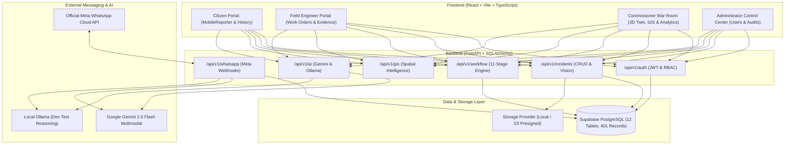

# CivicSense AI — Master Project Audit
**Document:** `docs/MASTER_PROJECT_AUDIT.md`  
**Application Version:** CivicSense AI OS v5.0  
**Audit Timestamp:** 2026-11-11T17:05:00+05:30  
**Scope:** Full-Stack Architecture, Security Boundaries, Integrations, and Production Readiness  

---

## 1. Executive Architecture Summary

CivicSense AI is an enterprise AI-powered municipal civic governance platform designed for closed-loop civic complaint reporting, automated multimodal AI triage, dynamic GIS digital twin intelligence, field crew operations, and executive war room management.

---

## 2. Comprehensive Subsystem Audit & Classification

Each component is classified into one of the canonical states:
- `COMPLETE AND VERIFIED`
- `IMPLEMENTED BUT NOT VERIFIED`
- `PARTIALLY IMPLEMENTED`
- `MOCK IMPLEMENTATION`
- `BROKEN`
- `MISSING`
- `BLOCKED BY EXTERNAL PROVIDER`
- `REQUIRES USER APPROVAL`

| Subsystem / Feature | Classification | Description & Evidence | Dependencies & Risks |
|---|---|---|---|
| **Database Connection & Dialect** | `COMPLETE AND VERIFIED` | `psycopg3` (`psycopg[binary]>=3.2.0`) installed and verified with SQLAlchemy. PostgreSQL dialect confirmed compatible with Supabase. | Production credentials stored in Render environment variables. |
| **Database Reconciled Schema** | `COMPLETE AND VERIFIED` | 12 tables confirmed populated in Supabase PostgreSQL (401 reconciled records). | Production mutations, migrations, and Alembic resets strictly prohibited without explicit user approval. |
| **Authentication: Signup** | `COMPLETE AND VERIFIED` | `POST /api/v1/auth/signup` strictly enforces citizen role only; rejects self-assignment of staff roles; rate-limited. | Rate limiter table `RateLimitLog`. |
| **Authentication: Login** | `COMPLETE AND VERIFIED` | `POST /api/v1/auth/login` verifies bcrypt hash, validates `is_active`, issues JWT access/refresh tokens; rate-limited. | Requires password input; demo prefill must be removed in production. |
| **Authentication: Password Recovery** | `MISSING` | No backend endpoints (`/auth/forgot-password`, `/auth/reset-password`) or frontend modal exist. | Must be implemented locally. |
| **Authentication: Four-Role Login UI** | `COMPLETE AND VERIFIED` | Restored four permanent role selectors (Citizen, Engineer, Commissioner, Admin) in `LoginPage.tsx`. Verified 0 errors. | Must ensure password prefill is disabled in production. |
| **Citizen Portal: Complaint Submission** | `PARTIALLY IMPLEMENTED` | `MobileReporter.tsx` captures categories, photos, voice notes, and GPS/manual address, but submits base64 dataUrls instead of calling `apiUploadIncidentImage`. | Needs durable photo upload integration. |
| **Citizen Portal: Duplicate Detection** | `PARTIALLY IMPLEMENTED` | UI displays duplicate count, but backend returns hardcoded count 0 instead of checking nearby open incidents with matching category. | Spatial distance query needed in `create_incident`. |
| **Citizen Portal: Complaint History & Tracking** | `COMPLETE AND VERIFIED` | `ComplaintHistory.tsx` lists tickets, filters by status/severity, sorts, searches, and displays live stage timeline. Scoped to authenticated user. | Relies on backend `/incidents/` RBAC scoping. |
| **Citizen Portal: Escalation & Feedback on Web** | `MISSING` | Available on WhatsApp (`escalate`, `rate`), but missing as dedicated HTTP endpoints and UI controls on web portal. | Needs backend endpoints & UI modals. |
| **Field Engineer Portal: Work Orders** | `COMPLETE AND VERIFIED` | `FieldEngineerPortal.tsx` implemented in Phase 3A: displays assigned orders, category, severity, SLA countdown, accept/reject, work started, field notes, before/after evidence, resolve, GPS navigation, GIS jump. | Backend scoping verified in `test_auth_rbac.py`. |
| **Commissioner War Room & Executive Suite** | `COMPLETE AND VERIFIED` | `ExecutiveDashboard.tsx`, `CommissionerWarRoom.tsx`, `CityDigitalTwin3D.tsx`, `DigitalTwinGISMap.tsx`, `SmartBudgetPlanner.tsx`, `AIReportGenerator.tsx` fully intact and verified. | Connected to `/api/v1/dashboard/kpis`, `/wards`, `/departments`, `/gis/intelligence`. |
| **Administrator Control Center** | `MOCK IMPLEMENTATION` | `UserManagementPanel.tsx` currently displays hardcoded mock users and mock audit logs with zero backend API connectivity. | Real backend `/api/v1/admin/` endpoints must be implemented. |
| **Central 11-Stage Workflow Engine** | `COMPLETE AND VERIFIED` | `WorkflowService.transition_stage()` drives all 11 lifecycle stages, records `WorkflowHistory`, `AuditLog`, `Notification`, and triggers WhatsApp alerts. | Used by both Web and WhatsApp handlers. |
| **Meta WhatsApp Cloud API Webhook** | `IMPLEMENTED BUT NOT VERIFIED` | Webhook verification (`GET`), signature verification (`POST` HMAC-SHA256), in-memory LRU deduplication, background task queueing, conversational draft, media download, Gemini vision analysis, location geocoding, complaint tracking, staff login, and RBAC actions implemented. | Mocked in tests (46 tests passed). Real live messaging requires valid Meta credentials and user approval. |
| **AI Engine: Vision Pipeline** | `COMPLETE AND VERIFIED` | Gemini 2.5 Flash Multimodal analyzes binary image bytes. Magic bytes check and size limits enforced in `image_security.py`. Fallback gracefully handled. | Requires valid `GEMINI_API_KEY`. |
| **AI Engine: Command OS / Copilot** | `COMPLETE AND VERIFIED` | Dual chat interface using Ollama locally or Gemini in cloud, with fallback response generator. | Tested in `test_ai_service.py`. |
| **Evidence Storage Provider** | `IMPLEMENTED BUT NOT VERIFIED` | `storage_service.py` supports `local` disk storage and `s3` AWS SigV4 presigned URLs. Local storage is active in development. | Durable S3/R2 storage requires production bucket configuration. |
| **Security: RBAC & IDOR Enforcement** | `COMPLETE AND VERIFIED` | Citizens can only read/access own complaints. Engineers can only read/access/transition assigned orders. Non-assigned access rejected with HTTP 403. | Verified across 46 automated backend tests. |

---

## 3. Key Gaps Requiring Immediate Implementation

1. **Administrator Portal Real Backend & Frontend (Phase 5):**
   - Create `backend/app/routers/admin.py` with:
     - `GET /api/v1/admin/users`: Real user directory with pagination and role filters.
     - `POST /api/v1/admin/users`: Staff account creation (engineer, commissioner, admin) with audit log.
     - `PATCH /api/v1/admin/users/{user_id}/status`: Toggle active/inactive.
     - `PATCH /api/v1/admin/users/{user_id}/role`: Role assignment.
     - `GET /api/v1/admin/audit-logs`: Live platform audit trail.
     - `GET /api/v1/admin/system-status`: Health, database, AI, WhatsApp, and rate limiter status.
   - Refactor `UserManagementPanel.tsx` to bind to these real endpoints, eliminating all mock data.

2. **Citizen Escalation, Satisfaction Feedback & Additional Evidence (Phase 2):**
   - Add backend endpoints:
     - `POST /api/v1/incidents/{incident_id}/escalate`: Citizen escalation request with reason.
     - `POST /api/v1/incidents/{incident_id}/feedback`: 1–5 star rating and comment on resolved incidents.
     - `POST /api/v1/incidents/{incident_id}/additional-evidence`: Citizen attaches extra notes or photo.
   - Wire these actions into `IncidentDetailsPage.tsx` and `ComplaintHistory.tsx`.

3. **Citizen Complaint Photo Upload & Real Spatial Duplicate Detection (Phase 2):**
   - In `MobileReporter.tsx`, upload image via `apiUploadIncidentImage` so `photoUrl` is a durable storage reference.
   - In `create_incident`, calculate nearby open duplicates within 150m.

4. **Secure Password Recovery Flow (Phase 1):**
   - In `backend/app/routers/auth.py`, implement `POST /auth/forgot-password` and `POST /auth/reset-password`.
   - In `LoginPage.tsx`, remove production password prefilling and add "Forgot Password?" modal.

5. **Documentation & Verification Matrices (Phases 11–15):**
   - Generate all required documentation in `docs/`.
